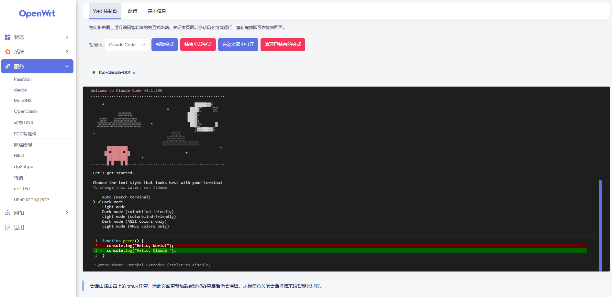

# luci-app-fcc

[简体中文](README.md) | **English**

Manage [FCC (Free Claude Code)](https://github.com/Alishahryar1/free-claude-code)
and its coding agents from the LuCI web interface on OpenWrt / ImmortalWrt.

Three pages, one package:

| Page | What it does |
| --- | --- |
| **Web Console** | A real interactive terminal for Claude Code, Codex, Pi, OpenCode, Cline, Hermes, DeepSeek Harness, Grok Build, Muse Code and Aider — one tmux session per agent, in the browser. |
| **Configuration** | Server settings (address, port, log level), install and backup paths, the agent picker, install/uninstall/complete uninstall, updates, start/stop/restart, the diagnostics report, the FCC Admin link (the runtime panel refreshes every two seconds and pauses while the tab is hidden), and control of the FCC server on one other machine over SSH. |
| **Basic Information** | Version, status, PID, uptime, RSS memory, CPU and hardware platform, system memory and storage. |

`luci-app-fcc` is a **control layer only**. It ships Lua, JavaScript and POSIX
shell. It does **not** contain Python, Node.js, `uv`, the FCC runtime or any
coding agent — those are installed separately, on demand, under `/opt/fcc`.



---

## Install

OpenWrt 24.10:

```sh
opkg install luci-app-fcc_*.ipk
opkg install luci-i18n-fcc-zh-cn_*.ipk   # Chinese interface
```

OpenWrt 25.12:

```sh
apk add --allow-untrusted luci-app-fcc-*.apk
apk add --allow-untrusted luci-i18n-fcc-zh-cn-*.apk   # Chinese interface
```

The `.ipk` and the `.apk` are produced by CI from the corresponding OpenWrt SDK.
They are genuinely different package formats — an `.ipk` renamed to `.apk` is
not a package and will not install.

Then open `LuCI → Services → FCC`. All three pages work immediately, before
anything else is installed.

English is the source language and ships in `luci-app-fcc`; the compiled
Simplified Chinese catalogue is a **separate package, `luci-i18n-fcc-zh-cn`**,
which LuCI loads by itself whenever the interface language is Chinese — no
configuration, no service restart. The two are independent and can be
installed, upgraded and removed separately.

### Build from source

To trim the package into a firmware or change it locally, put the source in the
OpenWrt build tree and compile it with the rest:

```sh
cd openwrt
./scripts/feeds update -a
./scripts/feeds install -a
git clone https://github.com/Arthur97172/luci-app-fcc.git package/luci-app-fcc
make menuconfig   # LuCI → Applications → luci-app-fcc
make package/luci-app-fcc/compile V=s
```

The package lands under `bin/packages/<arch>/`. The same source produces an
`.ipk` in a 24.10 tree and an `.apk` in a 25.12 one; `VERSION` and
`PKG_RELEASE` give the version in the file name.

---

## First run

**1. Install the FCC runtime.** On the *Configuration* page, choose an agent and
press **Install**. The page fetches the official installer over HTTPS, records
its SHA-256, and runs it. Python, `uv` and the runtime itself go under the
configured install path (`/opt` by default, so the runtime lands in `/opt/fcc`),
never into this package.

* The agent picker defaults to **All agents** — the whole registry: an extremely
  slow download that takes about 8 GB of storage. Choose only the agents you
  need. Choosing one agent installs just that agent (plus the runtime if it is
  missing) and leaves the other installed agents alone. If a runtime is already
  installed and **All agents** is selected, the page asks first, then removes
  the runtime and installs every agent again — upstream never reinstalls an
  existing agent, so removing the runtime is the only way to replace a damaged
  one.
* **Check the free space first: the filesystem holding the install path needs at
  least 2 GB available, and 4 GB is recommended.** When there is less, this
  package refuses the install before downloading anything and says how much is
  missing. The runtime peaks at around 741 MB measured; an update keeps the new
  runtime beside the old one, and `uv`'s cache grows with the Python it builds.
  The rollback copy goes to the **Backup path**, `/tmp/fcc` by default — `/tmp`
  is tmpfs on OpenWrt, which keeps it off the flash the runtime lives on — and
  is removed when the run ends.
* The installer only reads `/dev/tty`, with no flag or environment variable that
  skips it. This package runs it inside a `tmux` session, answers its questions
  according to the agent selected on the *Configuration* page, and writes the
  whole terminal to `<install_path>/logs/installer.out` — the first place to
  look when an install fails.
* **The progress bar is not an estimate — it means "still running".** It eases
  toward 95% and stops there, reaching 100% only when the job ends and its lock
  is released.
* **The log is append-only, and the page shows the current run.** Each run starts
  with a `===== fcc job start <time>: <command> =====` line. For earlier runs,
  read `<install_path>/logs/fcc-runtime.log` (install) or `fcc-update.log`
  (update) on the router; when the install path is not writable they fall back
  to `/tmp/fcc-logs/`.
* Clicking install or update again while a job is running is refused with
  `another install/update is already running`. A lock left behind by a killed
  job goes stale after at most an hour.

**2. Configure.** Set the address and port, then **Open FCC Admin** to add
provider credentials. API keys are entered in FCC's own admin UI and are never
stored in UCI. The **Install path** and **Backup path** fields can be changed at
any time; changing the install path does not move an existing runtime.

> **Keep the address at `127.0.0.1`** unless you deliberately need to reach the
> FCC Admin page from another device. The FCC server's own default is `0.0.0.0`;
> this package overrides it and will not accept a bind address that is not a
> literal IP.

**3. Use an agent.** On the *Web Console* page, pick an agent and press
**Start**. Each agent gets its own session, named `fcc-<agent>-NNN`.

**4. Update.** *Configuration* → **FCC Runtime** → **Check for updates** →
**Update FCC**. The check runs only when that button is pressed; opening or
returning to the tab does not reach the network. **Clear record**, after
**Uninstall completely**, removes both the version table and the job record —
progress bar and log — and disables **Update FCC**. The update
itself is a sequence: it checks free space, warns about open console sessions,
saves the current state, stops the server, reinstalls, verifies the binary,
restarts, and confirms the server is answering before reporting success.

If any step fails, the previous runtime is put back. The old runtime tree is
*renamed* aside rather than copied — instant on one filesystem, no extra space —
so restoring it needs no download. Your `data/` is copied. After a rollback the
log says `Previous FCC version restored` or, if the restored server will not
start, `FCC Server remains stopped. Please inspect logs.` LuCI itself is
untouched either way.

---

## LAN control

The **FCC Server** section of the *Configuration* page carries a
`[This router] [LAN]` switch. On `[LAN]` the same four buttons — **Start**,
**Stop**, **Restart** and **Open FCC Admin** — drive the FCC server on one other
machine: Windows, Linux, macOS or OpenWrt, one at a time.

1. With **IP address** and **Username** filled in, press **Generate and
   configure key**. The router creates an Ed25519 key pair under `/etc/fcc/ssh/`
   and shows the public half; add it to the remote account's authorized_keys
   file — the page names the exact path for the platform you chose:
   `/home/<account>/.ssh/authorized_keys` on Linux (`/root/.ssh/authorized_keys`
   for root), `/Users/<account>/.ssh/authorized_keys` on macOS (where Remote
   Login also has to be switched on in System Settings → General → Sharing),
   `/etc/dropbear/authorized_keys` for OpenWrt's Dropbear, and on Windows
   `C:\ProgramData\ssh\administrators_authorized_keys` for an administrator or
   `C:\Users\<account>\.ssh\authorized_keys` for a standard account. No password
   is stored or asked for: the connection offers this key and nothing else
   (`PreferredAuthentications=publickey`, `BatchMode=yes`,
   `IdentitiesOnly=yes`).
2. Press **Test connection**. The first time, the remote host key's fingerprint
   is shown and has to be confirmed; once confirmed it is stored in UCI and
   every later connection must match it exactly. A changed fingerprint refuses
   the connection and reports the value it actually found.
3. Only then do the four buttons become usable. The command a click sends is
   chosen by **Remote platform** in *Advanced settings*; on Linux and OpenWrt it
   first asks whether that machine has a service, and uses its own launcher when
   it does not:

   - **Linux**: `systemctl cat <service>.service` — when the unit is there,
     `systemctl <op>`; when it is not, which is what an upstream
     `uv tool install` leaves behind, the launcher: `fcc-server` is started in
     the background with its output appended to `~/.fcc/server.log`, and stopped
     by finding it in the process list.
   - **OpenWrt**: `/etc/init.d/<service>` when it is there, the launcher when it
     is not.
   - **macOS**: always the launcher (the upstream install registers no launchd
     job).
   - **Windows**: one PowerShell line that asks the machine whether it has a
     service of that name: if it does, `Start-Service` / `Stop-Service` /
     `Restart-Service`; if it does not — which is what install.ps1 leaves — the
     upstream install's own server, started hidden with `fcc-server` and
     stopped through its process list, because the installer registers no
     Windows service.

   A service name may contain only letters, digits and `.` `-` `_`.

The launcher route needs `pgrep` on that machine (Linux, macOS and OpenWrt have
it by default), because "did it come up" and "did it stop" are questions for the
process list. A failure names the one that happened: no FCC Server installed on
that machine is reported as "install it first"; a server that was started but
did not come up has the location of `~/.fcc/server.log` written out; no `pgrep`
is said plainly, rather than the buttons promising more than they do. The
**Web Console** is unaffected: in LAN mode it asks that machine's own shell —
`sh` on Linux and macOS, PowerShell on Windows, with the directories the
installer wrote added to PATH first — lists its agents and can start them there.
The server state is asked of the service manager first and, when there is no
such unit or service, read from the process list, so a hand-started server is
not reported as stopped.

While the server is running the LAN panel shows the same six lines as
`[This router]`: running, version, process ID, uptime, memory (RSS) and
listening on. A machine carrying this package answers with its own `status.sh`;
a machine carrying only the upstream runtime — Linux, macOS, OpenWrt and Windows
have no `status.sh` — is asked the same questions of its own process list and
launcher instead: the PID, memory and uptime come from the process, the
listening address from its listening socket in `ss`, `lsof` or `netstat` — on
Windows from `Get-NetTCPConnection`, falling back to `netstat -ano` where that
cmdlet does not exist — and the version from `fcc-server --version` (upstream
documents running it as safe). Whatever cannot be read shows `—` rather than a
guess. On Windows the questions are asked through PowerShell and have yet to be
verified on a real machine.

**Only private IPv4 addresses are accepted** (`10/8`, `172.16/12`, `192.168/16`,
`169.254/16`). Hostnames are refused: a name can resolve to a public address.

The remote FCC Admin is loopback-only too, so **Open FCC Admin** does not open
`http://<remote-ip>:8082` directly. LuCI's proxy first opens an SSH local
forward, `ssh -N -L 127.0.0.1:18082:127.0.0.1:<admin-port>`, and hands the
request to this end of it: the remote server sees a loopback peer, while the
browser's access still goes through LuCI's own login. The tunnel is opened when
Admin is first reached and closed when LAN mode is left. It needs that machine's
sshd to allow **local** forwarding (`AllowTcpForwarding`, `yes` by default;
`local` for local only). On a **Linux** machine the buttons arrange that
themselves, and on most machines no configuration has to change at all:
**Start** first works out, without root, the value that machine's sshd really
applies — the main configuration and the `/etc/ssh/sshd_config.d/*.conf` files
its `Include` lines splice in are readable by anyone, and they are scanned in
sshd's own order, first match wins (`sshd -T` answers the same question but
reads root-only host keys, so an ordinary account cannot run it). When the value
is already `yes`, `all` or `local` — or nothing is written at all, since
OpenSSH's default is `yes` — the tunnel opens as it is: no file is written, no
privilege is asked for, and the page reports `allowed`.

Only a machine that really blocks forwarding is changed: **Start** tries an
installed root helper, `/usr/local/sbin/fcc-local-forwarding on`, first, and
otherwise writes `/etc/ssh/sshd_config.d/00-fcc-local-forwarding.conf` (a single
line, `AllowTcpForwarding local`); both paths validate with `sshd -t`, reload
sshd, and only then start the server. **Stop** removes the file and reloads only
after the server has really stopped; **Restart** deletes it, writes it again and
then restarts the server. The file's name sorts before the other
`sshd_config.d/*.conf`, and sshd keeps the **first** value it meets, so the file
takes effect even when an `AllowTcpForwarding no` was already there — that file
itself is left untouched.

Writing to `/etc/ssh` needs root: an account that is root writes directly, any
other account goes through the helper when it is installed and `sudo -n`
otherwise (no blanket passwordless sudo is needed — a `sudoers` rule allowing
just `mkdir`, `tee`, `sshd -t` and the reload is enough). When none of that
works the buttons still start and stop the server and show the outcome of this
step as one sentence — permission denied, a file of that name this package did
not write, a configuration `sshd -t` rejected (rolled back), and a failed reload
each have their own wording, and none of them counts as a failed start or stop.
macOS and OpenWrt do not read that directory, so nothing is changed on those
machines.

For a machine that does block forwarding and whose administrator does not want
to hand that account `tee` into `/etc/ssh`, the page's **One-time setup on the
LAN machine** gives a block to paste once: `sudo sh -s` as an administrator
(`sh -s` where that machine logs in as root), which installs the helper and a
`sudoers` rule allowing only `fcc-local-forwarding on` and
`fcc-local-forwarding off`. The program accepts those two words and nothing
else, so it can change this one setting and nothing more — a far smaller grant
than a list of commands. How sshd is reloaded here (systemd unit, SysV script,
`/etc/init.d`) lives in the helper, which is the only part that differs between
distributions. The password is typed by that machine's administrator and is
never stored or asked for by this package.

When forwarding is switched off and cannot be changed from here, Open FCC Admin
returns a 502 and the page says that machine's sshd refused the forward and
which setting to change, rather than only `Connection reset by peer`.

The connection needs an OpenSSH client **on the router**; the client on the
remote machine is not used. Dropbear also answers as `/usr/bin/ssh` but does not
support the options this feature passes, and the page says exactly that. Install
the missing helpers with:

```sh
opkg install openssh-client-utils     # 24.10 and earlier
apk add openssh-client-utils          # 25.12 and later
```

*Advanced settings* holds the SSH port, the remote platform, the Admin port and
the service name, shows the exact command each button sends, and shows the
pinned fingerprint with a **Forget** button. Changing the address or the SSH
port forgets the fingerprint on its own.

---

## Requirements

Installed automatically as dependencies:

```
luci-base  luci-compat  curl  ca-bundle  tmux
```

`tmux` is not optional: it is the terminal backend the Web Console drives.

* **`tar`** is deliberately not a dependency, but busybox tar is not good
  enough: `uv` unpacks its own release with
  `tar xf … --no-same-owner --strip-components 1`, which busybox does not
  implement. The diagnostics decide by **actually unpacking an archive**. It is
  not a dependency because on 25.12 upstream's tar carries a variant gate
  (`TAR_XZ` on, `xz-utils` off by default) that makes this package
  unselectable; the preflight installs it instead.
* **`bash`** is needed by the installers of Claude Code, OpenCode, Hermes, Grok
  Build and Muse Code. When the selected set needs it the diagnostics report a
  FAIL with the install command, otherwise a WARN; the preflight installs it.
* **`cline`** cannot be fixed by any package: Cline publishes glibc Linux builds
  only and OpenWrt is musl. It is dropped from the selected set with a line
  saying why, and when it was the only agent asked for the install is refused
  with `AGENT_UNSUPPORTED`. Upstream request:
  [cline/cline#15271](https://github.com/cline/cline/issues/15271).
* **`git`** is needed for one agent only: the Hermes installer clones its
  sources over HTTPS, which OpenWrt ships in `git-http` (which pulls `git` in).
* **`luci-compat`** brings `luci-lua-runtime`, the Lua dispatcher and template
  engine this package's controller and views run on. Without it the package
  installs cleanly and the pages are simply never reachable.
* The FCC runtime has its own requirements — Python 3.14, FastAPI and Uvicorn.
  Those are the runtime's business: installing `luci-app-fcc` must not pull a
  language runtime onto a router that only wanted the status page.

### Packages the preflight installs

*Configuration* → **Diagnostics** → **Run checks** lists every check with its
value, requirement and result. When **Install** or **Update** is pressed and
*every* failing check is one a package can clear, the installer adds those
packages, asks the diagnostics again, and only downloads the runtime once the
report passes. A failure no package remedies — free space, DNS, unreachable
HTTPS, no Node build for the CPU — refuses the install with the full report.

| Check | Package | Needed when |
| --- | --- | --- |
| tar | `tar` | GNU tar, for `--strip-components` and `--no-same-owner` |
| tmux | `tmux` | The console and the installer, always |
| bash | `bash` | Claude Code, OpenCode, Hermes, Grok Build, Muse Code |
| fold | `coreutils-fold` | Codex's installer |
| sleep | `coreutils-sleep` | Pi's installer, whose sleep must take fractions |
| git | `git-http` | The Hermes installer clones its repository (includes `git`) |
| Node's C++ runtime | `libstdcpp6`, plus `libgcc1` if needed | The musl Node fetched by Pi, DeepSeek Harness and Hermes |
| curl | `curl` | Downloading the installer and the runtime |

The names are the same on 24.10 (opkg) and 25.12 (apk); the command follows the
image (`opkg install` / `apk add`), with one repository-index update and a retry
when the first attempt fails. **Clear check log**, beside **Run checks**, empties
the panel and nothing on disk; the log viewer on *Basic Information* has its own
**Clear log** with the same behaviour.

---

## How the Web Console works

The console is a genuine terminal, not a log viewer. Each session is a `tmux`
session on the router; the browser talks to it through the LuCI backend.

**The transport is an HTTP byte stream, not a WebSocket.** A WebSocket would
need a long-running Node.js or Python server — forbidden here, since the package
must not add a language runtime or run a persistent daemon beyond the FCC server
itself — and `uhttpd` has no WebSocket support. So the backend exposes the
session's output as a byte stream with **absolute offsets**, and the browser
long-polls it: a reconnect resumes exactly where it stopped. Scrollback is capped
and trimmed from the front, with the base offset advancing by exactly the number
of bytes dropped. Keystrokes travel as base64, are decoded to bytes, and are
re-encoded as hex for `tmux send-keys -H` — the value handed to tmux is never
attacker-controlled text.

The cost is one long-poll round trip of echo latency: the server looks at the
session's output file every 0.2 seconds, with the poll interval capped at 25
seconds server-side. BusyBox's `sleep` takes whole seconds, so the fast tick is
coreutils' `timeout`; a machine without it falls back to the old one-second
tick — still usable, but a keypress can take a second to show. For an
interactive coding agent that is not noticeable; for a full-screen TUI redraw it
can be.

**Open in browser** on the toolbar puts the current session in a window of its
own. **Closing that window ends the session**; reloading it does not, because the
reattach cancels the delayed close. **End all sessions** ends every session this
console created after a confirmation — only the `fcc-*` namespace. **Clean up
finished sessions** reaps only sessions whose process has already exited, and
their leftover files.

---

## Repository layout

```
Makefile                  explicit Package/ definitions (no luci.mk)
VERSION                   the upstream version (the release number is PKG_RELEASE)
luasrc/controller/fcc.lua the LuCI dispatcher and the JSON API
luasrc/fcc/               util.lua, agents.lua, paths.lua, adminproxy.lua
luasrc/view/fcc/          the three pages and the popout
htdocs/luci-static/…/fcc/ browser JavaScript and xterm.js
root/etc/init.d/fcc       procd service for the FCC server
root/usr/libexec/fcc/     the shell backend
root/usr/share/luci-app-fcc/agents.conf   the agent registry
po/                       translation catalogues
scripts/                  gen-po.sh, package-check.sh, smoke.sh, test.sh, version.sh
tests/                    the check suite
```

`luasrc/` maps onto `/usr/lib/lua/luci/`, so `luasrc/fcc/util.lua` is the module
`luci.fcc.util`. The install manifest in the Makefile mirrors that, and
`tests/test_packaging.sh` fails if the two ever disagree.

### Adding an agent

Add one line to `root/usr/share/luci-app-fcc/agents.conf`:

```
id|Friendly Name|launcher|default_install|approx_size_mb|min_ram_mb|probe
```

The `probe` column is the *underlying* CLI used to read a version, and must
never be an `fcc-*` launcher — those start the agent. Leave it empty when the
underlying CLI is unknown or unsafe to run (`hermes --version` hangs). Real
state is always detected dynamically; the file is a hint.

---

## Development

Everything runs on a normal Linux machine. No OpenWrt tree, no cross-compiler,
no root:

```sh
sh scripts/test.sh            # package-check + every suite
sh scripts/test.sh -q         # summaries only
sh scripts/test.sh lua shell  # named suites
sh scripts/package-check.sh   # the static package check on its own
sh scripts/gen-po.sh          # regenerate po/templates/fcc.pot
sh scripts/gen-po.sh --check  # fail if the template is stale
```

| Suite | Covers |
| --- | --- |
| `shell` | shebangs, POSIX portability, the prefixed-local contract |
| `lua` | module logic, plus Lua↔shell parity for shared rules |
| `runtime` | the backend's behaviour: path canonicalisation, id grammars, JSON, cache, `/proc`, terminal offsets |
| `packaging` | the install manifest against the tree, dependencies, the i18n wiring |
| `i18n` | template ↔ catalogue parity, po2lmo's drop rule, LuCI language codes |
| `security` | no committed credentials, no WAN bind, POST-only mutations, ACL scope, no WebSocket server |

`scripts/smoke.sh` is deliberately not part of `test.sh`: it needs Docker and a
release root filesystem, so CI runs it as its own job. It unpacks the official
rootfs, boots it under a real procd, installs the built package with that
release's own package manager (`opkg` on 24.10, `apk` on 25.12), and runs
`/etc/init.d/fcc status` inside it.

The shell backend runs under `set -u`, and POSIX `sh` has a single global scope
shared by every function, so every local is prefixed with a per-function tag
(`_ug_v`, `_ou_off`), enforced by `tests/test_shell.sh`.

### Releases

`VERSION` (the upstream version, also shown on *Basic Information*) and
`PKG_RELEASE` in the Makefile (the release number) compose the package's
version, and that one string is used three times: the file name, the tag and the
release name. `scripts/version.sh` is the one place that composes it, and there
is no tag to push. A push to `main` runs the static checks, builds once against
the 24.10 SDK and once against the 25.12 SDK, install-smoke-tests each in its
own release rootfs, and publishes only if all of it passes; the workflow creates
the tag itself. Bumping `PKG_RELEASE` is what cuts the next release. Publishing
under a version that already has a release replaces it, so re-running is
idempotent; a pull request never publishes.

The assets are this package alone — `luci-app-fcc_<version>-r<release>_all.ipk`,
`luci-app-fcc-<version>-r<release>.apk` and `SHA256SUMS`. The package is
`PKGARCH:=all` (pure Lua, JavaScript and shell), so the file an x86_64 SDK
produces installs on ARM, MIPS and x86 alike. The FCC runtime is installed on
demand over the network, so there is no prebuilt runtime tarball in the release.

---

## Known limitations

* **No WebSocket transport for the console.** A consequence of the
  no-extra-runtime and no-persistent-daemon constraints; a full-screen TUI redraw
  is visibly slower than it would be over a socket.
* **`hermes` has no version probe.** `hermes --version` does not terminate, so
  the UI reports the version as unknown rather than hanging the status refresh.
* **Agent versions are probed, not guaranteed.** A version is read from the
  underlying CLI with a 5-second timeout and cached for 60 seconds.
* **The console and the runtime installer both need `tmux`.** Without it the
  console reports the missing dependency and an install is refused before it
  starts.
* **Five agents need `bash`.** See *Requirements*; the preflight installs it.
* **Cline cannot be installed on OpenWrt.** It ships glibc builds only, so the
  diagnostics report it as a WARN and an install drops it with a line saying why.
* **A whole-registry install is all-or-nothing.** Upstream stops at the first
  agent it cannot install and rolls the entire run back; pick that agent on its
  own from the dropdown to get the rest.
* **An update needs room for the new runtime before the old one is discarded.**
  Rollback moves the previous runtime aside, so the free-space preflight has to
  cover one runtime, not zero.

---

## License

GPL-3.0. See [LICENSE](LICENSE).
